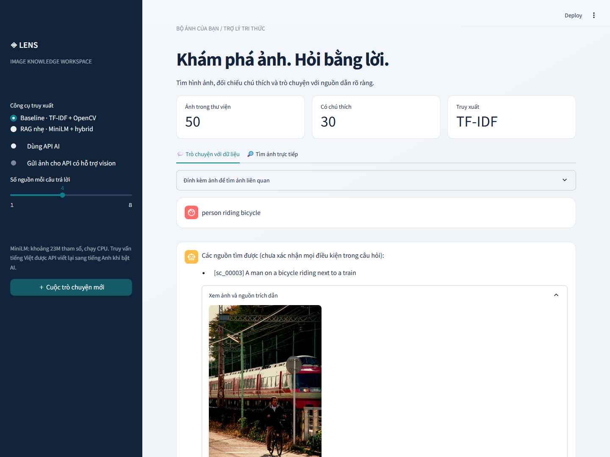
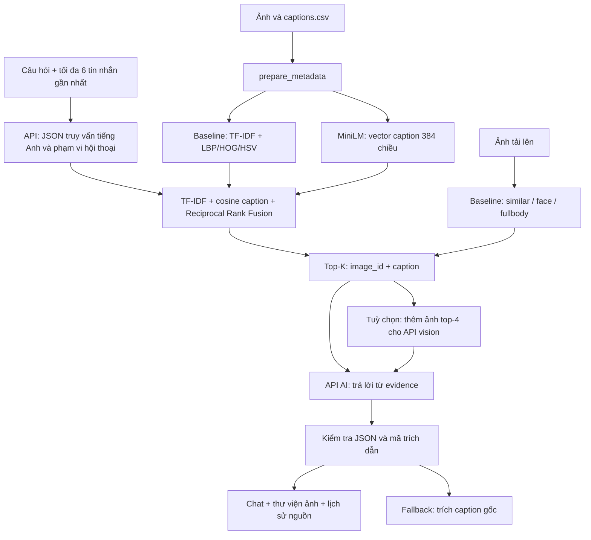

# Lens — Image Retrieval & AI Chatbot

Miniproject truy hồi ảnh và hỏi đáp có dẫn nguồn. Mặc định chạy baseline trước; có thể chuyển sang RAG nhẹ trên CPU. [Báo cáo triển khai và kiểm thử](docs/REPORT.md).



## Chạy nhanh

Khuyến nghị tạo môi trường riêng để tránh xung đột với các thư viện đang có trên máy:

```powershell
python -m venv .venv
.venv\Scripts\Activate.ps1
python -m pip install -r requirements.txt
$env:PYTHONIOENCODING = "utf-8"
```

Trên Linux/macOS: `source .venv/bin/activate`, bỏ dòng PowerShell đặt encoding.

Tạo `.env` dựa trên `.env.example`, điền `HF_TOKEN` nếu cần tải từ Hugging Face. Credentials API có thể nằm trong file **cục bộ** `key_vilao.key`:

```ini
url=https://api.vilao.ai/v1
model=YOUR_AUTHORIZED_MODEL
apikey=YOUR_KEY
```

Hoặc cấu hình `AI_BASE_URL`, `AI_MODEL`, `AI_API_KEY` trong môi trường / `.env`. Biến môi trường được ưu tiên hơn `.env`, và cấu hình AI từ môi trường được ưu tiên hơn file key. Không commit secrets.

```powershell
# Tải ảnh + sinh metadata nhất quán với caption vừa tải
python pull_data.py --n 30

# Baseline: không tải mô hình neural
python -m src.ingest --system baseline

# RAG nhẹ: tải MiniLM lần đầu, khoảng 23M tham số
python -m src.ingest --system lightweight

python -m streamlit run app.py
```

Mở `http://localhost:8501`. Sidebar mặc định là baseline. Chọn **RAG nhẹ**, bật **Dùng API AI** để hỏi bằng tiếng Việt và hỏi tiếp dựa trên lịch sử. Khi tắt AI, nên dùng từ khóa tiếng Anh vì caption và MiniLM hiện dùng tiếng Anh.

Khi đã có ảnh và captions: `python pull_data.py --skip-download`. Sau mỗi lần đổi dữ liệu hoặc model embedding, chạy lại ingest. Giao diện chặn index có metadata cũ. Không dùng index pickle tải từ nguồn không tin cậy.

## Luồng hệ thống



**Baseline:** TF-IDF caption cho truy vấn văn bản; Haar + LBP cho khuôn mặt; HOG cho toàn thân; HSV + HOG cho ảnh tương tự. Baseline có thể dùng độc lập, không cần API.

**RAG nhẹ:** `sentence-transformers/all-MiniLM-L6-v2`, đo trên model đã tải là **22.713.216 tham số**. Embedding chỉ áp dụng cho **caption**, không phải ảnh. Hợp nhất danh sách TF-IDF và cosine bằng `sum(1 / (60 + rank))`, lọc nhánh dense dưới `DENSE_MIN_SCORE` (mặc định 0,30). Điểm RRF không phải xác suất đúng. Ảnh tải lên dùng các đặc trưng baseline; đây là luồng đa phương thức thực dụng, không tuyên bố MiniLM là mô hình image-text.

**AI:** câu hỏi tiếng Việt được viết lại thành truy vấn tiếng Anh. Câu hỏi chỉ về các ảnh trước có thể giới hạn tập nguồn vào những ảnh đã được trả về. Generator nhận evidence hiện tại; câu trả lời JSON phải có mã trích dẫn nằm trong top-K và khớp mã trong nội dung. Nếu API lỗi hoặc trích dẫn không hợp lệ, trả caption gốc. Kiểm tra mã nguồn không bảo đảm mọi phát biểu của LLM đúng về ngữ nghĩa.

**Vision:** chỉ bật khi model API hỗ trợ ảnh. Gửi tối đa 4 ảnh nguồn, thu nhỏ còn 512px, và ảnh truy vấn nếu có. Mặc định tắt. API là dịch vụ bên ngoài; giới hạn dưới 100M áp dụng cho encoder RAG cục bộ, không áp dụng cho model sinh câu trả lời trên API.

## Dữ liệu

```text
data/images/scene/*.jpg
data/images/face/<person_id>/*.jpg
data/images/fullbody/<person_id>/*.jpg
data/captions.csv                  # path tương đối với data/images, caption
data/metadata.csv                  # image_id,path,category,caption,person_id
```

Ảnh không có caption vẫn tìm được bằng ảnh; chưa thể tìm theo nội dung caption. Không tự gán caption cũ cho ảnh đã bị tải đè. Tập đang kiểm thử có 50 ảnh scene, trong đó 30 ảnh có caption. Dataset gốc: [yerevann/coco-karpathy](https://huggingface.co/datasets/yerevann/coco-karpathy). Dữ liệu ảnh và index sinh ra không được push; tải lại theo lệnh phía trên.

`data/eval_queries.json` chứa 16 truy vấn gán nhãn thủ công theo 30 caption hiện tại, gồm 4 ca diễn đạt đồng nghĩa. Khi đổi dataset/split hoặc ID ảnh, phải kiểm tra lại nhãn. Loại ảnh truy vấn ra khỏi thư viện khi đánh giá truy hồi ảnh để tránh tự khớp.

## Kiểm thử và đánh giá

```powershell
python -m unittest discover -s tests -v
python -m src.eval.evaluate --systems baseline lightweight --k 3
python -m scripts.smoke                 # model thật, không gọi API
python -m scripts.smoke --api --vision  # gọi API thực, có thể tính phí
```

Kết quả ngày 22/10/2026, 16 truy vấn text trên tập nhỏ:

| Hệ thống | P@3 | R@3 | MAP@3 | Truy vấn warm trung bình |
|---|---:|---:|---:|---:|
| Baseline | 0,375 | 0,797 | 0,812 | 0,722 ms |
| RAG nhẹ | 0,521 | 0,969 | 1,000 | 12,881 ms |

Latency không gồm tải/khởi tạo model và API. MAP@K dùng mẫu số `min(số ảnh liên quan, K)`; MAP cao không có nghĩa mọi nguồn top-K đều đúng. Đây là kiểm tra chức năng trên tập rất nhỏ, không phải benchmark độc lập. Xem CSV trong `results/` và [báo cáo](docs/REPORT.md) để hiểu giới hạn.

## Các chế độ và phụ thuộc

| Chế độ | Lệnh cài | Trạng thái |
|---|---|---|
| Baseline + UI + API | `pip install -r requirements-base.txt` | Đã chạy thực tế |
| MiniLM hybrid + tải dataset | `pip install -r requirements.txt` | Đã tải model, build, truy vấn thực tế |
| CLIP + ArcFace + DETR + Qwen2-VL gốc | `pip install -r requirements-full.txt` | Giữ mã cũ, chưa kiểm thử model thật trong lần này |

Nhánh gốc: `python -m src.ingest --system rag`, đánh giá với `--systems rag`. Nhánh này có mô hình trên 100M và không nằm trong giao diện mặc định mới. Qwen2-VL-2B có thể cần GPU. Không coi kiểm thử fake encoder của nhánh này là bằng chứng chạy model thật.

## Cấu hình

| Biến | Mặc định / vai trò |
|---|---|
| `HF_TOKEN` | Token đọc từ `.env`, không hiển thị trên UI |
| `EMBEDDING_MODEL` | `sentence-transformers/all-MiniLM-L6-v2` |
| `EMBEDDING_THREADS` | 2 CPU threads |
| `DENSE_MIN_SCORE` | 0,30, cần hiệu chỉnh bằng tập validation riêng khi mở rộng |
| `AI_BASE_URL`, `AI_MODEL`, `AI_API_KEY` | Endpoint chat completions tương thích OpenAI |

Trong lần kiểm thử, model ghi trong key trả HTTP 403 vì chưa có quyền. `/models` của cùng key trả `claude-sonnet-5`, đã gọi thành công; máy cục bộ đặt `AI_MODEL` trong `.env` để dùng model được cấp quyền. Repo không chứa key hay `.env` thực.

## Cấu trúc mã

- `src/baseline/`: xử lý ảnh cổ điển và TF-IDF.
- `src/rag/lightweight.py`: encoder nhỏ, fusion, manifest index.
- `src/rag/chat.py`: API client, query planner, hội thoại, evidence, kiểm tra citation.
- `src/rag/embeddings.py`, `retriever.py`, `generator.py`: nhánh vision cục bộ gốc.
- `src/eval/`: Precision, Recall, AP/MAP và đo latency.
- `scripts/smoke.py`: smoke test model/API thật.
- `scripts/check_secrets.py`: rà staged files trước commit, không in secret.
- `tests/`: 25 kiểm thử offline, có fake cho API/encoder và baseline chạy thật.

## Trước khi push

`.gitignore` loại `.env`, `.env.*` (trừ `.env.example`), `*.key`, `*.pem`, model weights, cache, dataset ảnh và index. Sau khi stage:

```powershell
python -m scripts.check_secrets
git diff --cached --stat
```

Tham khảo encoder và cách encode: [model card MiniLM](https://huggingface.co/sentence-transformers/all-MiniLM-L6-v2).
